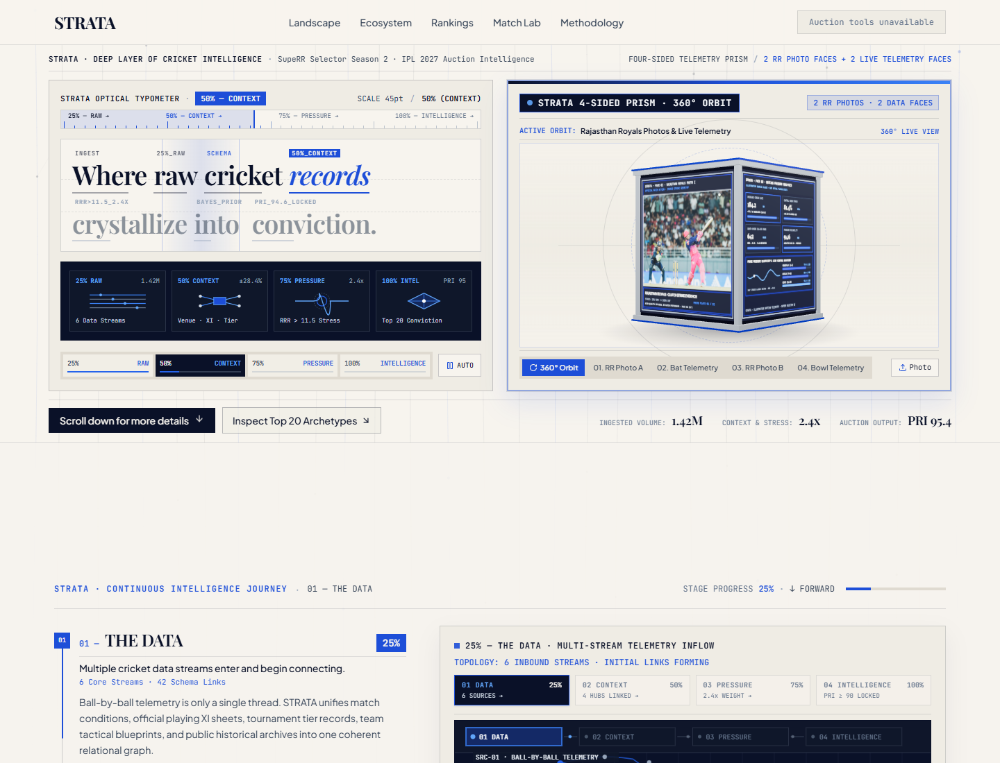
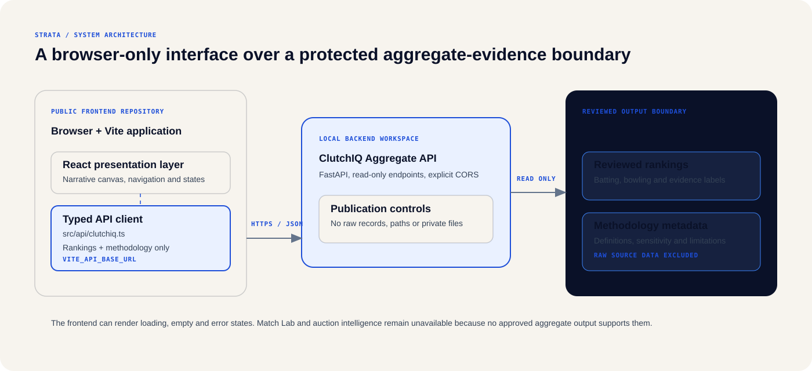

# STRATA

[Live website](https://strata-y6yz.onrender.com/) | [API health](https://strataa.onrender.com/healthz) | [System architecture](docs/SYSTEM_ARCHITECTURE.md) | [Demo script](docs/DEMO_VIDEO_SCRIPT.md) | [Download script PDF](docs/DEMO_VIDEO_SCRIPT.pdf)

## Current implementation and limitations

The repository now includes FastAPI in `backend/`, recovered Pandas/NumPy
analytics in `backend/integration_api/recovered/`, and the React/TypeScript/Vite
frontend. There is no persistent database. The architecture below contains older
frontend-era illustrations; the authoritative current architecture and six-table
data flow are in [SYSTEM_ARCHITECTURE.md](docs/SYSTEM_ARCHITECTURE.md).

Season averages can hide match context. STRATA compares performance during
pressure situations with historical expectations and reports evidence strength.
It does not establish an innate clutch trait or auction suitability.

Training precedes 2024-01-01; evaluation starts on that date. Historical cells
require 100 events and 10 matches. Batting adjusted rate is 100 times supported
residual runs divided by balls faced; bowling uses -6 times residual runs divided
by legal balls. Residuals are observed minus historical expected runs. Wickets
are reported, not added as an invented score bonus.

Match bootstrap uses 1,000 resamples and seed 7007. Empirical-Bayes shrinkage
pulls noisy estimates toward the cohort mean. Ordering is evidence tier, then
descending score, then player ID. Strong evidence requires 60 exposures and
8 matches with interval half-width at most 25 batting / 1.5 bowling; moderate
requires 30/5 and 40/2.5; limited requires 12/3. Missing public metrics remain
null. Read Methodology for exact pressure gates, formulas and limitations.

Hosted uploads remain bounded to 2 MiB/file, 6 MiB/job and 10,000 rows/file.
Local full mode allows 48 MiB/file, 64 MiB/job and 250,000 rows/file. Recent full
pack runs exceeded the 15-minute deadline; Render Free full-pack operation is
unverified. Approved production rankings remain a separate snapshot flow.

Backend setup from repository root: create a Python 3.12 virtual environment,
install `backend/requirements-test.txt`, and start
`python -m uvicorn integration_api.app:app --app-dir backend --port 8000`.
Set `CLUTCHIQ_OUTPUT_SNAPSHOT` to `<private-approved-snapshot-directory>` and
`CLUTCHIQ_CORS_ORIGINS` to `<exact-frontend-origin>`. Set the frontend's
`VITE_API_BASE_URL` to `<public-backend-url>`. Snapshot bootstrap additionally
uses `SNAPSHOT_GITHUB_REPOSITORY`, `SNAPSHOT_GITHUB_REF` (pinned commit) and
`SNAPSHOT_GITHUB_TOKEN` (private read-only secret). Never put credentials in VITE
variables. See [Render settings](backend/DEPLOYMENT.md).

Observed live health response on 17 November 2026:

```json
{"status":"ok","review_status":"phase_7b_reviewed"}
```

See live `/docs` for exact API schemas. Console routes under `/api/v1/live`
include `/schema`, `/uploads`, `/jobs/{job_id}`, companion uploads at
`/jobs/{job_id}/tables/{table}`, `/start`, `/cancel`, `/results`,
`/players/{player_id}`, `/structured.csv` and `/rankings.csv` under the job path.
Private jobs require `X-Analysis-Token`; DELETE on the job removes the session.

Contributors are recorded in GitHub history. Organizer data and private snapshot
files are not redistributed. Development assistance included Google AI Studio
and Codex; analytical results must remain independently inspectable.

> A visual cricket-intelligence frontend for inspected, aggregate pressure-performance evidence.

<p align="center">
  
</p>

STRATA is a Vite, React and TypeScript frontend that turns verified aggregate results into an editorial, animated exploration of cricket pressure performance. It preserves the existing visual narrative while connecting only approved ranking and methodology surfaces to the ClutchIQ read-only API.

> The animation above is an original system-flow illustration, not a recording of a match, a live deployment, or a claim that raw cricket data is exposed in the browser.

## What is live in this frontend

| Surface | Status | Evidence boundary |
| --- | --- | --- |
| Landing and data-storytelling experience | Available | Visual narrative; some storytelling content remains illustrative UI material. |
| Top 10 batters under pressure | API-backed | Reviewed aggregate ranking results only. |
| Top 10 bowlers under pressure | API-backed | Reviewed aggregate ranking results only. |
| Aggregate player evidence | API-backed | Exposure, matches, score, interval and evidence label; not a full player profile. |
| Methodology | API-backed | Approved scope, pressure definition, uncertainty, sensitivity and limitations. |
| Match Lab | Intentionally unavailable | No approved output supports simulations or tactical recommendations. |
| Auction intelligence, valuations and eligibility | Intentionally disabled | These claims are not exposed by the aggregate API. |

## Landing page captures

These are real local captures of the current frontend, made from the Vite development server on 14 November 2026. They document the existing landing experience and responsive composition; they are not synthetic mockups or representations of unpublished analytics.

| Desktop landing page | Mobile landing page |
| --- | --- |
|  |  |

## Architecture

<p align="center">
  
</p>

The frontend and analytics service are deliberately separate. The public frontend owns presentation and typed request handling; the local aggregate API owns reviewed-output access and CORS enforcement. Recovered analytical code is included in backend/integration_api/recovered; proprietary source data remains private.

<p align="center">
  
</p>

```text
Browser
  -> Vite + React application
     -> WeavePrototypeApp visual narrative and navigation
     -> RankingsAndProfilesSection
     -> MatchAndMethodologySection
     -> src/api/clutchiq.ts (typed fetch client)
  -> ClutchIQ Aggregate API (separate backend workspace)
     -> reviewed Phase 7A output snapshot
     -> Phase 7B-reviewed aggregate publication boundary
```

Production ranking requests return aggregates. Owned Console sessions can return supporting records from the user-uploaded pack; they do not distribute the private approved snapshot.

### API contract used by the frontend

The frontend reads its base URL from `VITE_API_BASE_URL` and currently calls:

| Method | Route | Used for |
| --- | --- | --- |
| `GET` | `/api/v1/rankings/batting?definition=rules_pressure&limit=10` | Top 10 batters |
| `GET` | `/api/v1/rankings/bowling?definition=rules_pressure&limit=10` | Top 10 bowlers |
| `GET` | `/api/v1/methodology` | Methodology and limitations |

The separate backend also makes aggregate player evidence available at `GET /api/v1/players/{player_id}?role=batting|bowling`. The current UI presents the approved aggregate evidence that accompanies a selected ranking row; it does not build a rich player dossier.

## Project structure

```text
frontend/
├── src/
│   ├── api/clutchiq.ts                  # Typed read-only API client
│   ├── App.tsx                          # Application entry
│   └── ui-prototype/
│       ├── WeavePrototypeApp.tsx        # Page composition and navigation
│       ├── components/                  # Narrative, canvas and evidence sections
│       ├── hooks/useScrollProgress.ts   # Scroll-driven motion state
│       └── lib/                         # Visual-intelligence helpers and tests
├── public/assets/                       # Existing frontend visual assets
├── docs/assets/                         # Original README architecture visuals
├── .env.example                         # Safe configuration template
└── package.json                         # Scripts and dependency contract
```

## Run locally

### 1. Start the aggregate API

The FastAPI service lives in backend/. From the repository root after creating a virtual environment and installing backend/requirements-test.txt:

```powershell
$env:CLUTCHIQ_CORS_ORIGINS="http://localhost:3000"
.\.venv\Scripts\python.exe -m uvicorn integration_api.app:app --app-dir backend --host 127.0.0.1 --port 8000
```

### 2. Configure and start this frontend

```powershell
cd frontend
Copy-Item .env.example .env
$env:VITE_API_BASE_URL="http://localhost:8000"
npm install
npm run dev
```

Open [http://localhost:3000](http://localhost:3000). The API is expected at `http://localhost:8000`.

`VITE_API_BASE_URL` is the only frontend value needed for the aggregate API. Do not place backend credentials, raw datasets or API secrets in this repository or in browser-visible environment variables.

## Live Analysis Console

Use **Open Live Console** on the landing page to inspect your own CSVs and run the recovered Phase 7A pressure methodology. The console provides raw and structured previews, validation, genuine job progress, batting/bowling results, uncertainty labels and private match/ball evidence. Uploaded results remain separate from approved production rankings.

The original delivery CSV requires five companion tables for analysis. Uploads are temporary (15-minute sessions; lost on restart), bounded to 2 MiB / 10,000 rows per file, and never written into public assets. Missing context or insufficient evidence produces an explicit unavailable/empty result. See [the implementation, CSV schema, API and Render guide](backend/LIVE_CONSOLE.md) for requirements and verification.

## Quality checks

```powershell
npm run lint
npm run build
```

There is no npm test script; run the existing Node tests and the live client tests directly:

```powershell
node --import tsx --test src/api/*.test.ts src/lib/*.test.ts src/ui-prototype/lib/*.test.ts server/*.test.ts
python -m pip install -r backend/requirements-test.txt
python -m unittest discover -s backend/tests -q
```

## Experience notes

- Scroll-driven background filaments and canvas scenes are rendered locally in the browser.
- Navigation retains the existing Landscape, Ecosystem, Rankings, Match Lab and Methodology anchors.
- Ranking tables visibly distinguish pressure score, exposures, matches, uncertainty and evidence level.
- Loading, unavailable, empty and API-error states are rendered instead of inventing fallback rankings.
- Match Lab and auction tools stay disabled until approved, API-supported outputs exist.

## Security and publication boundary

- `.env` files, `node_modules`, build output and logs are ignored by Git.
- `.env.example` contains placeholders and a local API URL only.
- This frontend is designed for aggregate evidence, not raw analytical distribution.
- Do not commit raw datasets, generated ranking files, credentials, access tokens or local backend paths.
