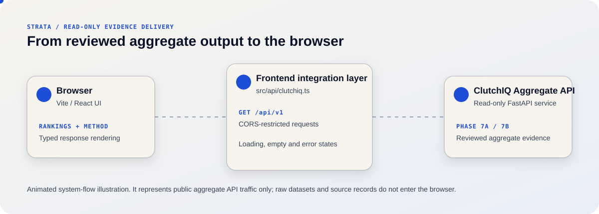
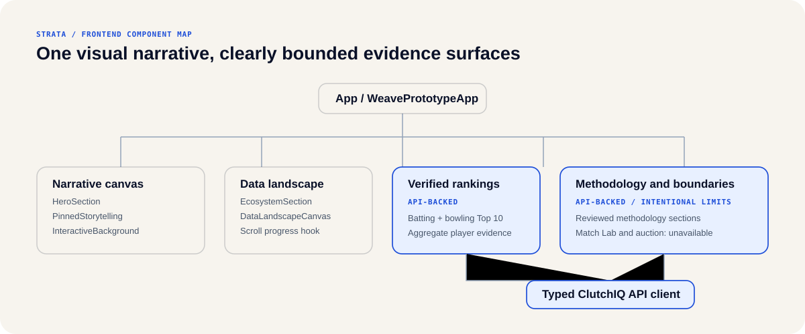

# STRATA

> A visual cricket-intelligence frontend for inspected, aggregate pressure-performance evidence.

<p align="center">
  
</p>

STRATA is a Vite, React and TypeScript frontend that turns verified aggregate results into an editorial, animated exploration of cricket pressure performance. It preserves the existing visual narrative while connecting only approved ranking and methodology surfaces to the ClutchIQ read-only API.

> The animation above is an original system-flow illustration, not a recording of a match, a live deployment, or a claim that raw cricket data is exposed in the browser.

## What is live in this frontend

| Surface | Status | Evidence boundary |
| --- | --- | --- |
| Landing and data-storytelling experience | Available | Visual narrative; some storytelling content remains illustrative UI material. |
| Top 10 batters under pressure | API-backed | Reviewed aggregate ranking results only. |
| Top 10 bowlers under pressure | API-backed | Reviewed aggregate ranking results only. |
| Aggregate player evidence | API-backed | Exposure, matches, score, interval and evidence label; not a full player profile. |
| Methodology | API-backed | Approved scope, pressure definition, uncertainty, sensitivity and limitations. |
| Match Lab | Intentionally unavailable | No approved output supports simulations or tactical recommendations. |
| Auction intelligence, valuations and eligibility | Intentionally disabled | These claims are not exposed by the aggregate API. |

## Landing page captures

These are real local captures of the current frontend, made from the Vite development server on 14 November 2026. They document the existing landing experience and responsive composition; they are not synthetic mockups or representations of unpublished analytics.

| Desktop landing page | Mobile landing page |
| --- | --- |
|  |  |

## Architecture

<p align="center">
  
</p>

```text
Browser
  -> Vite + React application
     -> WeavePrototypeApp visual narrative and navigation
     -> RankingsAndProfilesSection
     -> MatchAndMethodologySection
     -> src/api/clutchiq.ts (typed fetch client)
  -> ClutchIQ Aggregate API (separate backend workspace)
     -> reviewed Phase 7A output snapshot
     -> Phase 7B-reviewed aggregate publication boundary
```

The browser requests only aggregate responses. It never receives raw ball-by-ball records, source file paths, raw `source_records`, valuations, eligibility assertions or proprietary data.

### API contract used by the frontend

The frontend reads its base URL from `VITE_API_BASE_URL` and currently calls:

| Method | Route | Used for |
| --- | --- | --- |
| `GET` | `/api/v1/rankings/batting?definition=rules_pressure&limit=10` | Top 10 batters |
| `GET` | `/api/v1/rankings/bowling?definition=rules_pressure&limit=10` | Top 10 bowlers |
| `GET` | `/api/v1/methodology` | Methodology and limitations |

The separate backend also makes aggregate player evidence available at `GET /api/v1/players/{player_id}?role=batting|bowling`. The current UI presents the approved aggregate evidence that accompanies a selected ranking row; it does not build a rich player dossier.

## Project structure

```text
frontend/
├── src/
│   ├── api/clutchiq.ts                  # Typed read-only API client
│   ├── App.tsx                          # Application entry
│   └── ui-prototype/
│       ├── WeavePrototypeApp.tsx        # Page composition and navigation
│       ├── components/                  # Narrative, canvas and evidence sections
│       ├── hooks/useScrollProgress.ts   # Scroll-driven motion state
│       └── lib/                         # Visual-intelligence helpers and tests
├── public/assets/                       # Existing frontend visual assets
├── docs/assets/                         # Original README architecture visuals
├── .env.example                         # Safe configuration template
└── package.json                         # Scripts and dependency contract
```

## Run locally

### 1. Start the aggregate API

The FastAPI service lives in the separate ClutchIQ backend workspace. From that workspace:

```powershell
$env:CLUTCHIQ_CORS_ORIGINS="http://localhost:3000"
.\.venv\Scripts\python.exe -m uvicorn integration_api.app:app --host 127.0.0.1 --port 8000
```

### 2. Configure and start this frontend

```powershell
cd frontend
Copy-Item .env.example .env
$env:VITE_API_BASE_URL="http://localhost:8000"
npm install
npm run dev
```

Open [http://localhost:3000](http://localhost:3000). The API is expected at `http://localhost:8000`.

`VITE_API_BASE_URL` is the only frontend value needed for the aggregate API. Do not place backend credentials, raw datasets or API secrets in this repository or in browser-visible environment variables.

## Quality checks

```powershell
npm run lint
npm run build
```

The project has no configured frontend test script at present. The backend API is validated separately in its own workspace.

## Experience notes

- Scroll-driven background filaments and canvas scenes are rendered locally in the browser.
- Navigation retains the existing Landscape, Ecosystem, Rankings, Match Lab and Methodology anchors.
- Ranking tables visibly distinguish pressure score, exposures, matches, uncertainty and evidence level.
- Loading, unavailable, empty and API-error states are rendered instead of inventing fallback rankings.
- Match Lab and auction tools stay disabled until approved, API-supported outputs exist.

## Security and publication boundary

- `.env` files, `node_modules`, build output and logs are ignored by Git.
- `.env.example` contains placeholders and a local API URL only.
- This frontend is designed for aggregate evidence, not raw analytical distribution.
- Do not commit raw datasets, generated ranking files, credentials, access tokens or local backend paths.
