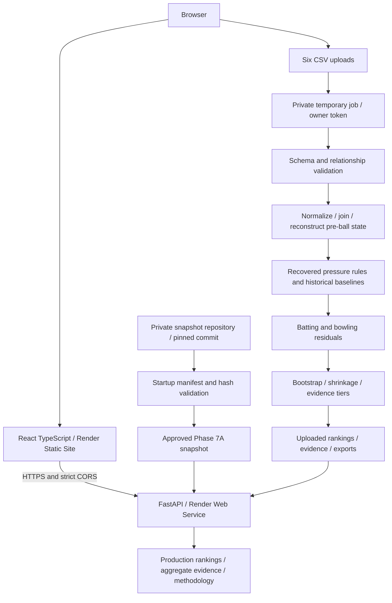
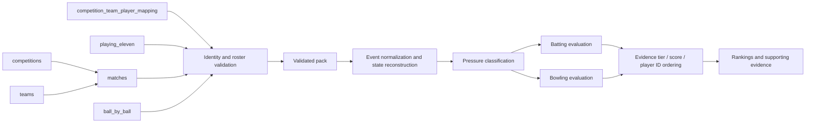
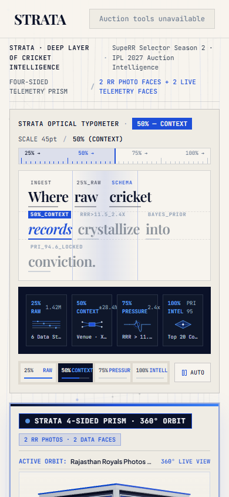

<div align="center">

# STRATA
### Deep layers of cricket intelligence.
**Understand the pressure. Inspect the performance. Follow the evidence.**

[](LICENSE)
[](https://react.dev/)
[](https://fastapi.tiangolo.com/)

[**Explore STRATA**](https://strata-y6yz.onrender.com/) ? [Architecture](docs/SYSTEM_ARCHITECTURE.md) ? [Deployment guide](backend/DEPLOYMENT.md)

Built by **[Sarthak Sulkhlan](https://github.com/Sarthaksulkhlan)** for
**[CRP Superrr Selector Season 2 ? Help Shape Rajasthan Royals' IPL 2027 Auction Strategy](https://unstop.com/hackathons/crp-superr-selector-season-2-help-shape-rajasthan-royals-ipl-2027-auction-strategy-rajasthan-royals-1792758)**.

</div>


*Actual local application capture, 14 November 2026.*

## The question behind STRATA

A season average tells part of a player's story. It does not tell you whether
runs came when resources were plentiful or when the match demanded more.

STRATA reconstructs the state before each delivery, identifies pressure
situations and evaluates batting and bowling against historical expectations.
Rankings come with exposures, match counts, uncertainty and evidence strength.
This supplies a pressure-performance perspective for player-selection research;
the scores describe performance rather than auction valuations.

## Explore the product

| Experience | What you can inspect |
|---|---|
| Batting rankings | Approved top-ten results and evidence strength |
| Bowling rankings | Separate role-specific pressure evaluation |
| Player evidence | Scores, exposures, matches and uncertainty |
| Interactive methodology | Processing flow, schemas, pressure rules and formulas |
| Live Analysis Console | Six-table validation, backend progress, private results and exports |
| Visual exploration | Responsive editorial layouts, animated scenes and navigation |

Open Rankings, switch between batting and bowling, then select a player to
inspect the evidence behind the score. Methodology explains how that score was
calculated. The Console handles separate uploaded analyses and displays the
active upload/session limits; it never replaces approved production rankings.

## System architecture



## Six-table data flow




Render hosts the React frontend as a Static Site and FastAPI as a separate Python
Web Service. Snapshot startup validates a pinned private revision. Uploaded jobs
use private temporary storage and owner-token access. No persistent database or
external queue is required.

## Six tables, connected context

| Table | Analytical role |
|---|---|
| competitions | Competition and format context |
| teams | Team identities |
| matches | Date, participants and match context |
| competition_team_player_mapping | Roster relationships and identity evidence |
| playing_eleven | Match participation |
| ball_by_ball | Delivery events, actors, runs and dismissals |

Validation checks schemas, record types, duplicate keys and relationships before
normalization and match-state reconstruction. Backend progress reports actual
processing stages; completed jobs expose rankings and supporting evidence.

## How the ranking works

**Establish context.** Historical training precedes 1 January 2024; evaluation
begins on that date. Pressure is evaluated from pre-delivery match state.

**Evaluate roles separately.** Residual runs are observed minus historical
expected runs. Batting adjusted rate is 100 times supported residual runs divided
by balls faced. Bowling uses -6 times supported residual runs divided by legal
balls, so conceding less than expected improves the score. Wickets remain
reported evidence rather than an arbitrary score bonus.

**Account for uncertainty.** Match bootstrap estimates an interval around the
adjusted rate. Empirical-Bayes shrinkage pulls noisy estimates toward the cohort
mean. Evidence tiers consider exposure count, matches and interval width.

**Order results.** Evidence tier comes first, then descending pressure score,
then player ID to resolve ties. Read the score together with its evidence tier
and interval. The interactive Methodology view explains exact gates and formulas.

## Technology

| Layer | Implementation |
|---|---|
| Interface | React 19, TypeScript, Vite, Tailwind CSS |
| Visuals | Motion, Three.js, Recharts |
| API | FastAPI, Uvicorn |
| Analysis | Python, Pandas, NumPy and recovered Phase 7A functions |
| Development | Express proxy and typed API clients |
| Storage | Private approved snapshot and temporary upload sessions |
| Hosting | Render Static Site and Python Web Service |
| Verification | Python unittest, Node tests, TypeScript checks and Vite build |

## Run locally

Use Node.js/npm and Python 3.12. From the repository root:

```powershell
npm ci
python -m venv .venv
.\.venv\Scripts\python.exe -m pip install -r backend/requirements-test.txt
$env:CLUTCHIQ_OUTPUT_SNAPSHOT="<absolute-private-snapshot-directory>"
$env:CLUTCHIQ_CORS_ORIGINS="http://localhost:3000"
.\.venv\Scripts\python.exe -m uvicorn integration_api.app:app --app-dir backend --port 8000
```

In a second terminal:

```powershell
$env:VITE_API_BASE_URL="http://localhost:8000"
npm run dev
```

Open http://localhost:3000. The approved snapshot is a private deployment input,
not a bundled public dataset. Credentials belong only in private service settings.

## Repository map

```text
src/api/                       Typed frontend API clients
src/components/                Shared methodology presentation
src/ui-prototype/              Landing and evidence sections
src/LiveAnalysisConsole.tsx     Upload-to-results interface
server/                        Local API proxy
backend/integration_api/       API, snapshots and private jobs
backend/integration_api/recovered/  Analytical functions
backend/tests/                 Regression and verification tools
docs/                          Architecture, setup and screenshots
render.yaml                    Two-service deployment configuration
```

## Verification and deployment

```powershell
npm run lint
npm run build
node --import tsx --test src/api/*.test.ts src/lib/*.test.ts src/ui-prototype/lib/*.test.ts server/*.test.ts
.\.venv\Scripts\python.exe -m unittest discover -s backend/tests -q
```

Manifest and SHA-256 checks protect approved artifact identity. Deterministic
settings and regression comparisons support reproducibility. See the
[deployment guide](backend/DEPLOYMENT.md) for service configuration and supported
processing profiles, and the [local guide](backend/FULL_DATASET_LOCAL.md) for
full-pack operation and resource verification.

## Mobile experience

<p align="center">

</p>

*Actual local application capture, 14 November 2026.*

## Built by

**[Sarthak Sulkhlan](https://github.com/Sarthaksulkhlan)** ? creator of STRATA.

Built for the Rajasthan Royals player-selection hackathon linked above.
Organizer data is not redistributed with the public source code.

## License

Original STRATA source code and documentation are licensed under the
[Apache License 2.0](LICENSE). Copyright 2026 Sarthak Sulkhlan.

Third-party dependencies and assets retain their respective licenses. This
license does not grant rights to organizer datasets, private snapshots,
player likenesses or third-party trademarks.
