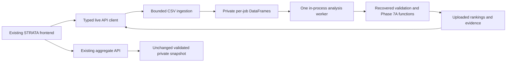

# Live Analysis Console — implementation and verification

## Current status — 15 November 2026

The implementation is already present in GitHub `main` at `34fc81a4486cc759296a6f27e4c7867a9c5ad323`, including the 20 implementation commits and reconciliation with the newer frontend/proxy work. The earlier verification section below is historical; its “not deployed” observations describe the initial implementation, not current production status.

This follow-up fixes one missing portrait URL by using the existing `player_2417_akeal_hosein_solo.jpg`. No image was generated or changed, and the profile layout/crop, analytical methods, production rankings and snapshot remain unchanged. The frontend CI workflow now executes the existing Node test suites as well as lint/build so a missing asset cannot silently pass those checks again.

| Area | Current verification |
| --- | --- |
| Backend | 31 tests passed, none skipped, including optional original-source parity and approved-snapshot regression checks |
| Frontend/proxy | 22 Node tests passed; TypeScript lint and production build passed |
| Local browser | Full upload-to-results flow, both roles, evidence, downloads, missing-session UI recovery, network errors, empty results, navigation and 1440px/390px layouts verified |
| Portrait | Corrected image loaded successfully in the actual hover card; all 19 catalog image references resolve to repository files |
| Single active console | `/#live-console`, `/#/live-console` and `/?view=live-console` each render one verified console |
| Live backend | Health, live schema, dashboard, methodology and both ten-row ranking endpoints returned HTTP 200 |
| Live ranking parity | All 20 live rows match the approved CSVs for player IDs/names, ranking order, evidence labels, exposures, matches, seasons, runs, wickets, rates, pressure scores, context coverage, shrinkage and uncertainty (numeric tolerance 1e-8) |
| CORS | Actual frontend origin preflight accepted with HTTP 200; untrusted origin rejected with HTTP 400 |
| Live browser | Production console retrieved its schema from `https://strataa.onrender.com/api/v1/live/schema` and enabled uploads without page errors; no test dataset was uploaded to production |

Earlier health/schema requests timed out; subsequent independent HTTP and browser checks succeeded. The cause of that transient failure is **not established** without Render logs. No configuration or backend code change was needed to restore connectivity during these checks. Existing Vite native-config/bundle-size warnings and a test-client deprecation warning remain non-fatal.

The portrait, CI and documentation follow-up changes were verified locally before publication. Publication status is recorded in Git history; these checks do not establish that Render has deployed the follow-up.

Security verification scanned 152 historical Git blobs and 114 working-tree project files for credential signatures and restricted historical data files; no findings were detected. No files were staged. This is evidence from the checks performed, not a guarantee that automated scanning can detect every possible secret.

### Reconciled routing and local setup

The existing header/hero buttons share the verified console. The Node development server proxies `/api/v1/live/*` to FastAPI, forwarding the ownership header and raw CSV bytes without running an alternate model. The former `/api/v1/live-console/*` contract returns HTTP 410 with migration guidance. Its old engine/UI source files are retained for history/tests but are not mounted as a second active analysis flow. Existing profile cards, images and aggregate API proxy remain intact.

For local verification, start FastAPI with the existing approved snapshot and explicit local CORS origin. Then, in the frontend repository terminal:

```powershell
$env:VITE_API_BASE_URL="http://127.0.0.1:8000"
$env:CLUTCHIQ_PRODUCTION_API_URL="http://127.0.0.1:8000"
$env:CLUTCHIQ_PRODUCTION_FRONTEND_ORIGIN="http://localhost:3000"
npm run dev
```

`npm run dev` now starts the existing Node/Vite development server, including the proxy. Do not start an additional competing analysis server. Production Static Site builds still use the public `VITE_API_BASE_URL` directly. These public URLs are not credentials; the snapshot token remains a backend-only secret.

## Scope and source recovery

This is an additive feature at `/#live-console`. The original landing page now has an **Open Live Console** link. Existing production rankings, dashboard, player evidence, methodology, animations, navigation, Match Lab and auction gating remain in their existing components and routes.

The original analytical source was recovered from the parent workspace's `analytics/` directory. The original ZIP contains **six CSV tables**, the competition brief and supporting archive metadata; it does not contain the analytical engine. The approved snapshot is aggregate/evidence output, not a substitute for source tables. The Phase 7B review and the authoritative Phase 7A implementation were inspected. The copied source files match the code hashes recorded by the approved snapshot manifest.

Only analytical **code** is included in this repository. No original delivery records, snapshot artifacts, user uploads or private dataset fixtures were copied here.

| Original source | Recovered code used | Original SHA-256 |
| --- | --- | --- |
| `analytics/event_contract.py` | Whole pure normalization module | `cde13d915f02b43dd705f8e158714c7d269194e92d7e5121378818c72baba366` |
| `analytics/validation.py` | Whole six-table validation module | `ce3f731843dd292e96cae9036bd47b61807c537ae7502cc11ffcde7f1031e236` |
| `analytics/state.py` | Whole match reconstruction module | `6442bf95bb4985f20cf40172597737ea1e8426928c46f90b0b3454cc2c11c0a8` |
| `analytics/ingest.py` | `KEYS`, `typed_table`; no ZIP or local-file loader | `7e3caf7a4175b4f7e8a3565393f1b033d1b0a02cd2f6c12f683d3f972943c47a` |
| `analytics/pressure_experiments.py` | `entry_roles` | `d25ea28e544bb9280f86418d304a71c4fd16f7162137fa2a3f8fd1ed8498b376` |
| `analytics/phase7a.py` | Training constants, `rate`, `thresholds`, `classify`, `baseline`, `summarize`, `shrink` | `b10914de78908a7f84ffc63f18dea92ae0418563c400b407ca404f06f93ba9cb` |

The recovered functions/classes are AST-identical to their original definitions. `live_pipeline.py` replaces file-based orchestration with in-memory calls. It reproduces the original CSV boundary's false comparison for absent dismissal IDs; otherwise nullable values would incorrectly stop batting calculations. It adds explicit empty/insufficient-input outcomes and stricter upload safety gates, without relaxing pressure or evidence thresholds.

## Architecture and security boundary



- One API process, one analysis worker, at most **two resident jobs**. Upload parsing is offloaded from the async request loop. Analysis jobs are queued, never mixed.
- **2 MiB and 10,000 rows per CSV; 6 MiB combined input per job**. At most 100 columns and 2,048 characters per cell. Upload streams have a 30-second timeout. These limits protect a free instance; the original full 41 MB delivery CSV exceeds them. Supply coherent subsets containing complete matches and historical training coverage; arbitrary row truncation is not valid analysis.
- Jobs expire 15 minutes after creation; a lifespan task purges expired inactive jobs every 30 seconds, and access/admission also performs cleanup. Active jobs are retained until their bounded processing finishes, then become eligible for expiry. Cancellation is cooperative at stage boundaries, not an unsafe thread interruption.
- Uploads and results live only in RAM. No database, paid disk, external queue, disk upload directory or permanent history exists. Restart/redeployment loses all jobs.
- Each job has a random ID and separate high-entropy access key. The key is returned once and sent in `X-Analysis-Token`, never in a URL, browser storage or logs. Keep it private. The UI retains it only in React state; leaving the page loses access.
- Status, source previews, result evidence, downloads, cancellation and deletion require the key. Unknown, expired and unauthorized jobs all return 404. Responses use `Cache-Control: no-store` and `X-Content-Type-Options: nosniff`.
- CORS retains the existing explicit origin allowlist and adds POST, DELETE and the job header. CORS is not authentication; the job capability protects data. Public upload admission remains bounded but anonymous: capacity exhaustion returns 429, not a guarantee of service against sustained abuse.
- Text-only UTF-8 CSV, strict parsing, bounded numbers, reserved provenance/derived-column rejection; no pickle, eval, spreadsheet execution, arbitrary local paths or ZIP extraction. CSV downloads neutralize formula-like string cells. Rendering uses React text escaping.
- Failure logs contain only an exception type, never uploaded values, traceback contents or job keys. The approved snapshot loader, secrets and manifest checks are unchanged.

## CSV contract and Pandas processing

Upload deliveries first (any `.csv` filename for a single delivery upload, or `ball_by_ball.csv` in a multi-file selection). Companion files use the exact table filenames below. All six are required before analysis. Missing companions produce a clear 409 and a disabled Start button, not generic averages disguised as pressure analysis.

| Table | Required columns |
| --- | --- |
| `ball_by_ball.csv` | `match_id, innings, overid, over_ball_num, innings_ball_num, batting_team_id, bowling_team_id, striker_id, non_striker_id, bowler_id, runs, extras1_runs, extras_2_runs, extras_type, is_wicket, dismissed_player_id, dismissal_type_id, dismissal_type, is_four, is_six, striker_name, non_striker_name, bowler_name` |
| `matches.csv` | `match_id, comp_id, match_date, home_team_id, away_team_id, toss_win_team_id, win_team_id, result, first_inn_revised_overs, second_inn_revised_overs, revised_target` |
| `competitions.csv` | `comp_id, comp_name, match_format` |
| `teams.csv` | `comp_id, team_id, team_name` |
| `competition_team_player_mapping.csv` | `comp_id, comp_name, team_id, team_name, player_id, player_name` |
| `playing_eleven.csv` | `match_id, team_id, player_id, batting_order, is_played, is_captain, is_wk, is_impact, is_impact_off` |

`GET /api/v1/live/schema` is the executable schema. Other original descriptive columns are retained and listed as additional columns; they are not pressure predictors. Alternate cricket formats are unsupported until their semantics can be mapped with evidence.

1. Validate byte size, encoding, header uniqueness, required columns, row widths, cell limits and numeric tokens. Identifiers must be finite integral positive values; fractional identifiers remain flagged by the event/key contract. Scientific notation and numeric tokens exceeding 15 integer digits are rejected before Decimal conversion.
2. `pd.read_csv(dtype=str, keep_default_na=False)` preserves raw strings, including literal `None` for no extras. Blank optional dismissal/revision fields remain blank.
3. Attach the exact upload SHA-256, fixed table name and one-based CSV record number (header excluded). User-supplied provenance is rejected.
4. Apply the original event contract to derive runs, bowler charge, balls faced/legal balls, dismissals and reason codes. Detect duplicate delivery keys; no source row is silently discarded. Duplicate keys block analytical joins through original validation.
5. Show original/processed/invalid/duplicate counts, per-column empty counts, first ten raw and structured records, and first 100 event issues. “Processed” for companion tables means parsed; relationship validity is established only after all tables arrive.
6. Validate original parent references and participation, reconstruct pre-delivery match state, reconcile complete innings with results, and quarantine unsupported contexts. An ambiguous extra is not relabelled as a no-ball. Match dates must be valid `YYYY-MM-DD` values; no dates or identities are invented.

## Methodology, scores and evidence

The primary `rules_pressure` model is used. No auction data or approved production records are mixed into uploads. Historical thresholds and baselines are fitted **only on the supplied pre-2024 matches**; evaluation begins `2024-01-01`. This uses the original methodology, but an uploaded subset has its own training population and is not expected to reproduce the full production leaderboard.

- Threshold cells: competition group × innings × innings phase, at least 100 events and 10 historical matches.
- Pressure window: at least 36 legal balls played, 6–60 balls remaining, 2–8 wickets remaining.
- First innings: scoring rate at/below historical Q25 with at most 6 wickets left, or death phase with at most 4 wickets left.
- Chase: required rate above historical Q70. First-innings target is never inferred from future chase outcomes.
- Role baselines: competition group × innings × phase × arrival role (batting) or phase (bowling) × exposure type; 100 events and 10 historical matches per cell.
- Residual = observed role runs − historical expected runs. Batting adjusted rate = `100 × supported residual runs / supported balls faced`; bowling adjusted rate = `−6 × supported residual runs / supported legal balls`. Wickets are separately reported, not assigned invented score weights.
- Original 1,000 match-bootstrap replicates with seed 7007. Confidence intervals describe the adjusted rate, not a bounded 0–100 score.
- Empirical-Bayes prior center = mean candidate adjusted rate; prior variance = `max(0, variance(adjusted rate) − mean(((CI high − CI low) / 3.92)^2))`. Shrink weight = prior variance / (prior variance + noise variance). Pressure score shrinks each adjusted rate toward that cohort center. Original undefined-weight fallback is preserved.
- Evidence tiers: strong = ≥60 exposures, ≥8 matches, CI half-width ≤25 batting / ≤1.5 bowling; moderate = ≥30, ≥5, ≤40 / ≤2.5; limited = ≥12 exposures and ≥3 matches; otherwise insufficient.
- Order by evidence tier, descending pressure score, then player ID. Show up to ten, never pad to ten. “Leading observed” identifies the first row with its evidence tier, not a universal best-player claim.

Results include all supported candidates, role-specific rates, shrinkage, intervals, context coverage, source-record counts, upload hashes, dataset summary and match checks. Owned player evidence links each pressure event to its uploaded record number and hash, and includes match aggregation and paginated delivery evidence. Exposure counts and evidence-row counts remain separate. CSV exports cover structured deliveries and all candidate rankings.

Retained methodological limitations include partial context coverage, the original bootstrap's treatment of all pressure-match exposures, sample-dependent prior/threshold estimates, and exclusion of incomplete/revised/ambiguous contexts. Uploaded results are labelled **not independently reviewed**. A successful computation is not Phase 7B certification. Alternative sensitivity rankings are not added to the console in this implementation; the production methodology endpoint remains unchanged.

## New endpoints

All routes are under `/api/v1/live`. No old endpoint contract changed.

| Method / suffix | Behavior |
| --- | --- |
| `GET /schema` | Columns, limits, prerequisites, methodology |
| `POST /uploads` | Raw `text/csv` delivery body → 201 job ID, access key, validation/previews |
| `POST /jobs/{id}/tables/{table}` | Raw companion CSV → 201 updated validation; duplicate/replacement/busy table → 409 |
| `GET /jobs/{id}` | Real state, accumulated stages, validation, missing tables, remaining TTL |
| `POST /jobs/{id}/start` | 202 queue admission; incomplete context/busy/already run → 409 |
| `POST /jobs/{id}/cancel` | 202 cooperative cancellation request; idle job → 409 |
| `GET /jobs/{id}/results` | Completed results or structured unavailable validation; not ready/no results → 409 |
| `GET /jobs/{id}/players/{player_id}` | `role=batting|bowling`, `offset≥0`, `limit=1..100` (default 50); metrics, match evidence, paginated ball evidence |
| `GET /jobs/{id}/structured.csv` | Formula-safe derived delivery CSV |
| `GET /jobs/{id}/rankings.csv` | Formula-safe all-role ranking CSV when complete |
| `DELETE /jobs/{id}` | 204 removal; active job must finish/cancel first |

Other errors: 408 upload timeout, 413 byte limits, 415 unsupported content type, 422 malformed CSV/schema/query, 429 capacity. Job states: receiving → validated → queued → running → complete / unavailable / failed / cancelled. Frontend polling follows actual processing; no artificial percentage or timer advances the analysis stage.

## Changed files

- `backend/integration_api/recovered/`: six source-derived analytical modules plus package initializer.
- `backend/integration_api/live_pipeline.py`: in-memory orchestration, methodology and evidence.
- `backend/integration_api/live_console.py`: secure ingestion, bounded jobs, owned results/export API.
- `backend/integration_api/app.py`: additive router, cleanup lifespan, strict CORS method/header extension and private response headers.
- `src/api/liveClient.ts`: typed live API client; `src/api/liveClient.test.ts`: transport/error tests.
- `src/LiveAnalysisConsole.tsx`: console, validation/preview, real status, rankings/evidence/downloads, error/empty states.
- `src/App.tsx`: hash navigation to the additional page.
- `src/ui-prototype/components/HeroSection.tsx`: additive console call to action.
- `backend/tests/live_fixture.py`, `test_live_console.py`, `test_live_provenance.py`, `test_live_regression.py`, `browser_live.py`: synthetic and optional private-source verification.
- `backend/requirements-test.txt`, `.github/workflows/backend-verify.yml`: install the HTTP test client in test environments; runtime requirements are unchanged.
- This document and the README navigation entry.

## Initial local verification (historical, before reconciliation)

Verification used Python 3.12.10 with a separate test environment installing the existing runtime requirements: Pandas 2.3.3, NumPy 2.5.4. No existing Python environment was downgraded. Original offline tests also ran in their existing environment.

- Backend suite: **28 tests passed, none skipped** with the optional local sources enabled: source recovery parity, original ZIP subset comparison, frozen snapshot endpoint regression, CSV/security/job tests and existing bootstrap/configuration tests.
- Original analytical suite: **102 tests run, 19 optional tests skipped, no failures**. Phase 7A artifact tests were enabled against the approved local snapshot.
- Frontend: **10 tests passed** (8 existing plus 2 client tests); TypeScript lint and production build passed. Existing Vite native-config and bundle-size warnings remain.
- Real source comparison: 20 complete IPL matches (10 historical and 10 evaluation) selected from original ZIP records. Pressure event membership, each candidate's exposures/matches, rates, context coverage, intervals, scores and evidence-first order checked against the original functions. No private test data was copied to the repository.
- All 23 approved manifest artifact hashes match; all 24 snapshot files remain unchanged. Existing API top-ten IDs, scores, exposures, labels and all twenty player responses were compared with approved CSVs.
- Chrome browser checks: real upload → validation → analysis → both role results → player evidence → export; 1440px desktop / 390px mobile without horizontal page overflow; landing/ranking/methodology navigation; invalid upload, network retry, missing-job session reset and insufficient-history empty result; no JavaScript page errors. Browser fixtures are explicitly synthetic tests, never app fallback data.
- Local Uvicorn startup passed with the real manifest-validated snapshot.
- All 24 changed/new files were inspected; credential-signature and restricted-file checks found no matches, the Git index is empty, and `git diff --check` passed. This was a local-change review, not a new audit of every historical Git object.
- Read-only live checks: `https://strata-y6yz.onrender.com` returned 200. At `https://strataa.onrender.com`, health, dashboard, both ten-row ranking endpoints and methodology returned 200 with the actual frontend CORS origin. A real Chrome visit to the live frontend also received both rankings and methodology without API network failures or page errors. `/api/v1/live/schema` returned **404**, as expected before deploying this local change.

Reproduce from the repository root:

```powershell
python -m pip install -r backend/requirements-test.txt
python -m unittest discover -s backend/tests -q
node --import tsx --test src/api/*.test.ts src/lib/*.test.ts src/ui-prototype/lib/*.test.ts server/*.test.ts
npm run lint
npm run build
git diff --check
```

Private verification tests require `STRATA_ORIGINAL_WORKSPACE`, `STRATA_ORIGINAL_ZIP` and `STRATA_APPROVED_SNAPSHOT` set to existing local sources. They skip in public CI, where those files are intentionally unavailable. The browser script requires a separate Playwright installation and installed Chrome, with local frontend/API servers running; its default frontend URL is `http://localhost:3011`. No browser package was added to production dependencies.

## Existing Render Free deployment

The base implementation is published and the live console schema has been verified as described above. Publishing the follow-up does not by itself verify deployment. For an approved release, update the **existing** services in this order:

1. Backend Web Service: root `backend`, build `pip install -r requirements.txt`, start `bash start.sh`, health `/healthz`, existing Python 3.12 setting. Keep exactly one Uvicorn process (do not set multiple `WEB_CONCURRENCY` workers or replicas). The existing startup script retrieves and validates the pinned private snapshot before Uvicorn binds `$PORT`.
2. Preserve private `SNAPSHOT_GITHUB_REPOSITORY`, pinned 40-character `SNAPSHOT_GITHUB_REF`, and read-only `SNAPSHOT_GITHUB_TOKEN` settings. Preserve `CLUTCHIQ_OUTPUT_SNAPSHOT=/tmp/clutchiq-snapshot/phase7a_v2_a`. Keep all secrets only in Render. No disk is needed for these new jobs.
3. Set/retain `CLUTCHIQ_CORS_ORIGINS=https://strata-y6yz.onrender.com` with no wildcard or trailing path. Redeploy the backend. Check `/healthz`, `/api/v1/live/schema`, both old top-ten endpoints and methodology. The private snapshot's manifest still contains 23 artifacts, not the historical count of 20.
4. Existing Static Site: repository root, build `npm ci && npm run build`, publish `dist`. Retain public `VITE_API_BASE_URL=https://strataa.onrender.com`; rebuild/redeploy the frontend after the backend is ready. This is a public URL, never a credential. Hash navigation needs no new server rewrite.
5. Open `https://strata-y6yz.onrender.com/#live-console`. Test with non-sensitive CSVs first. Verify real POST/GET requests, errors, deletion and the existing rankings. Never upload proprietary test fixtures to a public test service without authorization.

Cold starts may delay connections. A restarted instance returns 404 for previous jobs; re-upload rather than expecting recovery. The full analysis flow was verified locally; production received read-only connectivity checks, not a new upload-to-results test. Free-plan memory/concurrency limits deliberately preclude full unrestricted dataset uploads and permanent history.

Rollback: redeploy the previous reviewed frontend/backend revisions together. Existing production snapshot, source data, old API routes and Render variables require no migration. In-flight uploaded jobs are disposable by design.
