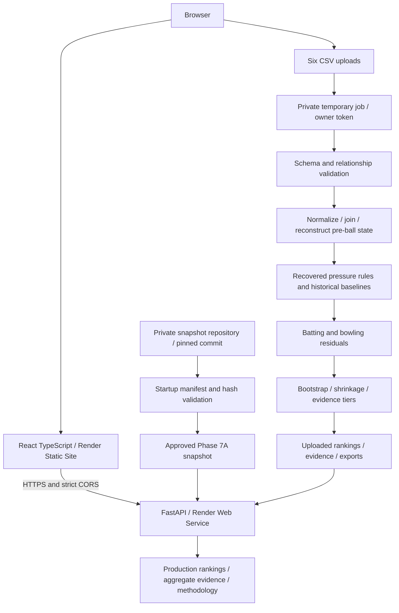
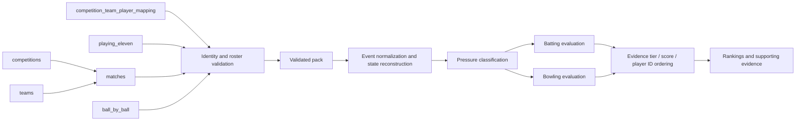

# STRATA system architecture

## Six-table data flow

The approved production snapshot and uploaded analyses are separate flows.
Uploads never replace production rankings. There is no persistent database or
external queue. One Python worker handles jobs; private temporary files and
memory hold session state. Restart loses sessions. Private job requests require
the owner token in `X-Analysis-Token`.

Render serves the frontend from `dist`; the Express development proxy is not
part of the Static Site runtime. Clients use `VITE_API_BASE_URL`. Backend startup
validates the pinned private snapshot before starting one Uvicorn worker on
Render's `PORT`. Credentials remain server-side.

Hosted limits are 2 MiB per CSV, 6 MiB per job and 10,000 rows per CSV. Local
full mode allows 48 MiB, 64 MiB and 250,000 rows respectively. Sessions have a
900-second deadline; cleanup respects active processing and exports. No durable
history is promised. Recent full-pack runs exceeded the deadline; Render Free
512 MiB/no-swap operation remains unverified.

See [deployment settings](../backend/DEPLOYMENT.md) and
[local full-pack instructions](../backend/FULL_DATASET_LOCAL.md).
